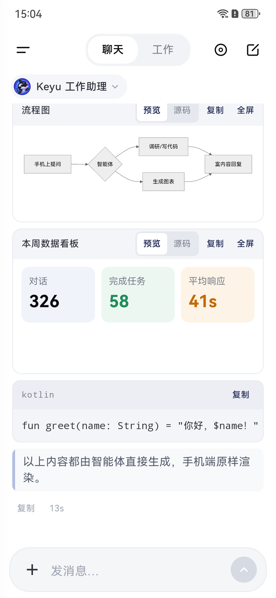
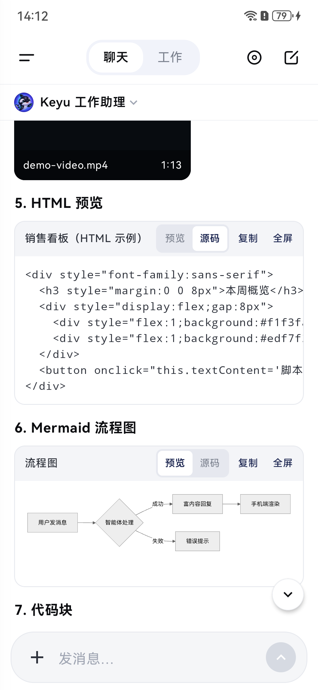
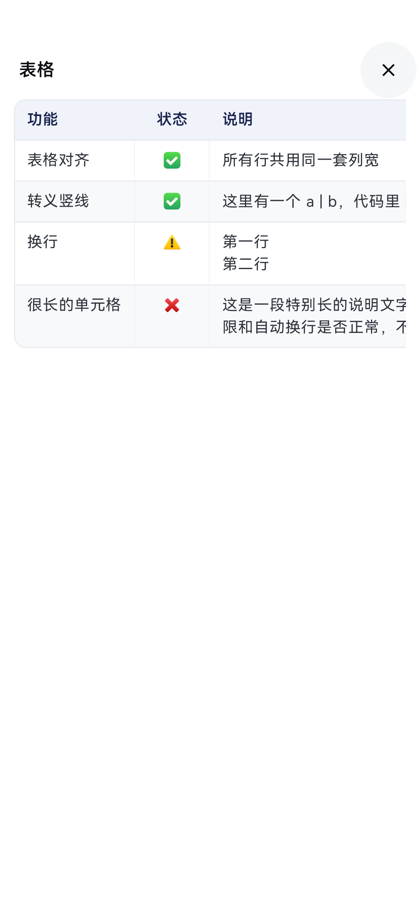
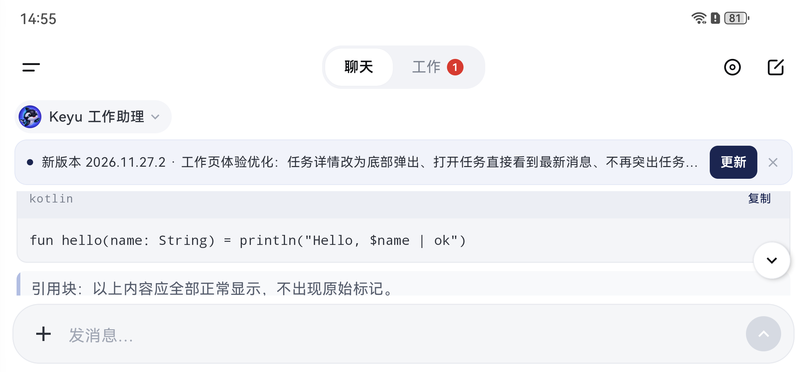

<p align="center">
  
</p>

<h1 align="center">Multica 助手（Android）</h1>

<p align="center">
  轻量级原生 Android 随行客户端，基于 Kotlin 与 Jetpack Compose 构建。<br />
  随时随地与 Multica 多智能体对话、处理任务收件箱，并在任意 App 上通过悬浮球截屏圈注反馈。
</p>

<p align="center">
  
  
  
  
</p>

---

## 核心特性

### 1. 多智能体对话（聊天）
- **会话管理**：支持切换工作区内任意智能体，侧边栏直观展示置顶、未读与实时「正在输入…」状态。
- **排队与引导**：默认排队发送不打断当前执行，也支持对排队消息置顶优先或立即停止任务。
- **思考过程摘要**：以折叠节点精炼展示智能体的思考与执行步骤，点击可展开细节，不堆砌底层日志。

### 2. 富内容消息渲染
- **完整 Markdown / GFM**：支持标题、粗斜体、删除线、引用、任务清单、嵌套列表、代码块一键复制。
- **对齐表格**：支持列对齐、转义竖线、单元格换行、宽表横向滑动、一键复制与全屏查看。
- **可视化与多媒体**：支持多图组合与高清大图预览、行内视频卡片播放、**沙箱 HTML 实时交互预览**、**Mermaid 流程图渲染**，并支持「预览 / 源码 / 复制 / 全屏」一键切换。

### 3. 工作收件箱与任务协作（工作）
- **收件箱聚焦**：支持「与我相关」与「全部」筛选、一键全部已读与归档。
- **任务对话**：直接在手机上查看任务详情、完整时间线评论与附件，并随时回复或唤起负责智能体。

### 4. 全局悬浮助手与截屏圈注
- **贴边悬浮球**：展示当前智能体头像，拖拽松手自动吸附屏幕边缘，闲置轻度半透明减少遮挡。
- **随手截屏圈注**：单击打开悬浮控制面板，长按直接截屏（Android 14+ 支持整屏捕获）；支持画笔/矩形框选标注、多色切换与文字/语音输入法速记。
- **批量收集发送**：可先连续「再加一条」收集多张标注截图或想法，再在底部确认面板统一发往当前会话或新建会话。

### 5. 后台通知与轻量 OTA 更新
- **离线回复提醒**：后台轮询接收新回复，支持系统通知与悬浮完成气泡，点击直达目标会话或任务。
- **APK 附件安装**：对话中收到 `.apk` 附件时自动呈现安装卡片；可选开启「同签名应用自动更新」（仅对本机已安装且签名严格一致的应用生效）。
- **无打扰自更新**：后台静默检查新版本，侧边栏下载图标轻亮提示；消息区顶部提供单行更新提示条（同一版本 24 小时最多提醒一次，15 秒无操作自动收起），下载后自动校验 `SHA-256 + 包名 + 签名` 覆盖安装。

---

## 界面预览

<table>
  <tr>
    <td align="center" width="33%">
      <br />
      <sub><b>对话首页与悬浮助手入口</b></sub>
    </td>
    <td align="center" width="33%">
      <br />
      <sub><b>Mermaid 流程图、HTML 看板与代码块</b></sub>
    </td>
    <td align="center" width="33%">
      <br />
      <sub><b>行内视频卡片与交互式 HTML 预览</b></sub>
    </td>
  </tr>
  <tr>
    <td align="center" width="33%">
      <br />
      <sub><b>HTML / Mermaid 预览与源码切换</b></sub>
    </td>
    <td align="center" width="33%">
      <br />
      <sub><b>GFM 表格全屏查看</b></sub>
    </td>
    <td align="center" width="33%">
      <br />
      <sub><b>非打扰顶部更新提示条</b></sub>
    </td>
  </tr>
</table>

---

## 快速开始

### 环境要求
- **JDK**：17
- **Android SDK**：`compileSdk 36`、`minSdk 29`（Android 10 及以上）
- **目标架构**：`arm64-v8a`

### 构建 APK

```bash
# 1. 克隆仓库
git clone git@github.com:keyu-ys/multica-keyu-android.git
cd multica-keyu-android

# 2. 配置本地 Android SDK 路径（可选同时预设服务器地址与固定签名，见 local.properties.example）
cp local.properties.example local.properties

# 3. 构建 Debug / Release APK
./gradlew assembleDebug
./gradlew assembleRelease
```

构建产物位于：
- Debug：`app/build/outputs/apk/debug/app-debug.apk`
- Release：`app/build/outputs/apk/release/app-release-unsigned.apk`（若配置了 `signing/release.keystore` 则输出已签名的 `app-release.apk`）

### 首次使用配置
1. 安装并打开 **Multica 助手**。
2. 在登录页填写你的 **Multica 服务器地址**（例如 `https://your-multica-server.example.com`）和 **工作区 slug**。
3. 输入工作邮箱并获取验证码，完成登录后即可开始对话或开启悬浮助手。

> 若希望团队内构建自带默认服务器地址或统一签名（确保后续版本可覆盖安装且不丢失登录态），可在本地 `local.properties` 中配置 `multica.defaultServer`、`multica.defaultSlug` 以及 `signing.*` 参数（`local.properties` 与 `*.keystore` 均已加入 `.gitignore`，不会提交到仓库）。

---

## OTA 更新接入（可选）

客户端内置三层版本清单解析策略，服务端按需配置任意一层即可启用应用内自更新：

1. **服务端全局配置**：`GET ${server}/api/config`
   - 返回 `android_client` 对象，或通过 `android_release_url` 指定清单 JSON 地址。
2. **固定发布目录**：`GET ${server}/releases/android/latest.json`
3. **兜底清单（可选）**：通过 `local.properties` 配置 `multica.otaIssueId`，读取对应 Multica Issue 描述中的 JSON 代码块。

清单 JSON 格式示例：

```json
{
  "pkg": "com.mtk.keyu",
  "version_code": 2026112702,
  "version_name": "2026.11.27.2",
  "url": "https://your-multica-server.example.com/releases/android/multica-keyu-2026.11.27.2-arm64.apk",
  "sha256": "<64位小写SHA-256>",
  "size_bytes": 3131126,
  "notes": "一句话更新说明"
}
```

---

## 项目结构

核心代码全部位于 `app/src/main/java/com/mtk/keyu/`，保持单模块扁平组织、低依赖与高可维护性：

| 分类 | 核心文件 | 说明 |
| :--- | :--- | :--- |
| **主界面与设置** | `MainActivity.kt`、`Work.kt`、`Settings.kt`、`Theme.kt`、`Icons.kt`、`Avatar.kt` | 聊天主界面、工作收件箱与任务详情、登录与设置页、品牌主题与自定义图标 |
| **富内容渲染** | `Markdown.kt`、`RichWeb.kt`、`RichMedia.kt`、`AttachmentImage.kt`、`ThinkingProgress.kt` | GFM 解析与表格布局、沙箱 HTML / Mermaid WebView、视频卡片、图片画廊与思考进度摘要 |
| **悬浮与截屏标注** | `BubbleService.kt`、`CaptureService.kt`、`FloatPanelOverlay.kt`、`AnnotateOverlay.kt`、`AnnotateUi.kt`、`AnnotateActivity.kt`、`Outbox.kt` | 贴边悬浮球、MediaProjection 整屏捕获、深色悬浮控制面板、全屏涂鸦圈注与多条待发草稿箱 |
| **网络与状态** | `Api.kt`、`AppState.kt` | Multica REST API 客户端、全局响应式状态缓存 |
| **通知、安装与更新** | `ReplyService.kt`、`Notify.kt`、`Installer.kt`、`InstallReceiver.kt`、`AutoUpdater.kt`、`UpdateTip.kt` | 后台消息轮询与系统通知、同签名校验 APK 安装器、静默 OTA 引擎与顶部更新提示条 |

---

## 权限说明

| 权限 | 用途 |
| :--- | :--- |
| `INTERNET` | 连接 Multica 服务端与加载在线媒体 / Mermaid 渲染脚本 |
| `SYSTEM_ALERT_WINDOW` | 展示贴边悬浮球、悬浮控制面板与回复完成气泡 |
| `FOREGROUND_SERVICE` / `MEDIA_PROJECTION` | 仅在开启悬浮助手截屏时捕获屏幕画面，支持 Android 14+ 整屏捕获 |
| `POST_NOTIFICATIONS` | 后台收到智能体回复或工作通知时发送系统提醒 |
| `REQUEST_INSTALL_PACKAGES` | 仅用于应用内 OTA 自更新及用户确认后的 APK 附件安装 |
| `REQUEST_IGNORE_BATTERY_OPTIMIZATIONS` | 可选，用于降低系统后台查杀导致通知延迟的概率 |
