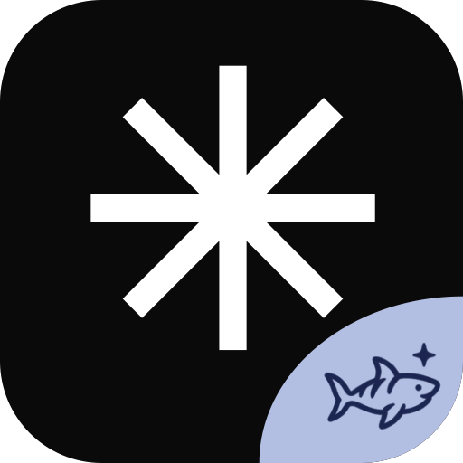
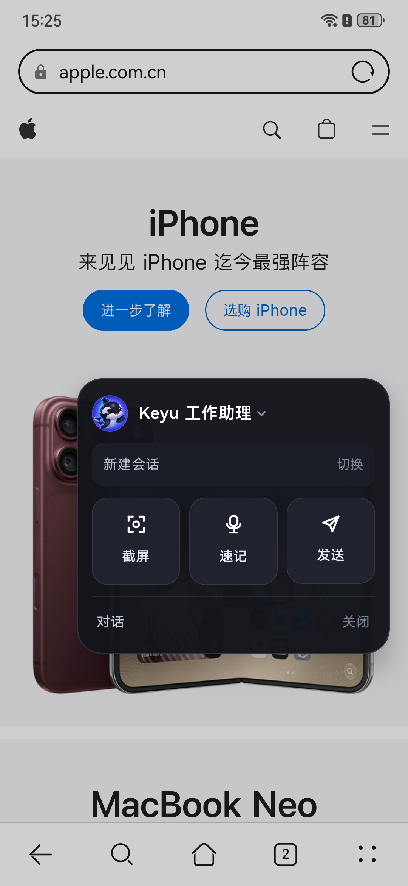
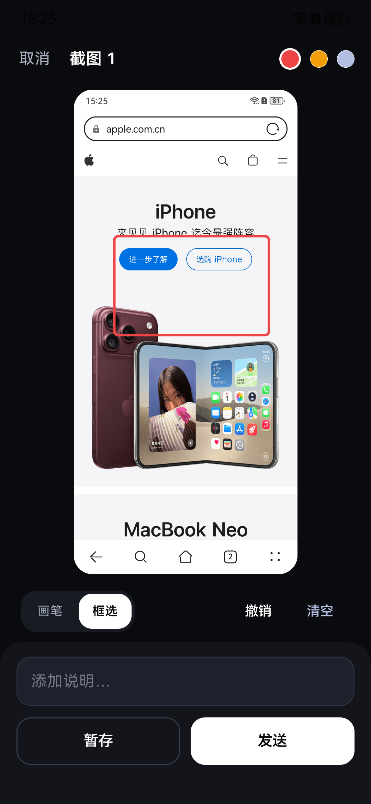
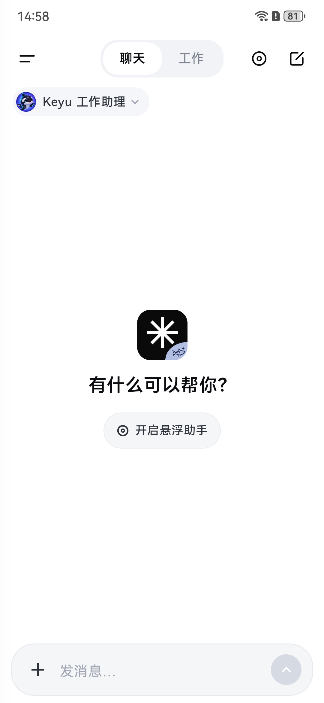
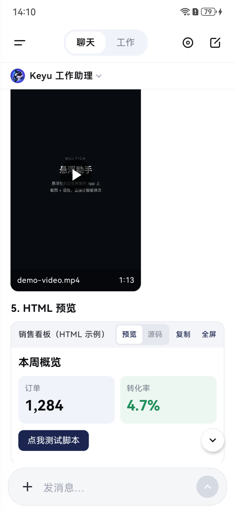

<p align="center">
  
</p>

<h1 align="center">Multica Android 客户端（Multica 助手）</h1>

<p align="center">
  <b>开源、轻便、开箱即用的 Multica 手机端（Android App）</b><br />
  Multica 官方目前暂未提供移动客户端 —— 这款开源安卓端让你在手机上随时召唤多智能体，<br />
  并通过<b>跨应用悬浮球</b>，在任何页面随手截屏、圈画、说话，把想法和问题直接交给 AI 处理。
</p>

<p align="center">
  <a href="#为什么好用尤其是悬浮助手">核心体验</a> ·
  <a href="#实机界面">实机界面</a> ·
  <a href="#3-步上手">3 步上手</a> ·
  <a href="#english-overview">English Overview</a>
</p>

---

## 为什么好用（尤其是悬浮助手）

### 1. 悬浮助手：不切 App，看到什么直接圈给智能体
很多时候灵感、问题或资料并不在聊天窗口里，而是在你正在浏览的网页、文档、设计稿或任意手机应用里。开启**悬浮助手**后，一颗贴边悬浮球会安静地停在屏幕边缘：

- **随手截屏圈注**：点开悬浮面板点「截屏」（或**长按悬浮球直接秒截**），立即进入全屏标注——画笔涂鸦、红框圈重点，补一句文字或直接用输入法语音说想法，不用先存相册再切 App 找图。
- **多条先暂存，一次发完**：体验一个产品或看一篇长文时，发现好几处想聊的地方？每截一张点「暂存」攒起来，最后一口气发给选定的智能体，上下文清晰完整。
- **随时速记，不打断当下**：脑子里闪过一个念头，点悬浮面板「速记」立刻记下来发走，当前在看什么完全不中断。
- **发完就走，做完提醒**：任务交给后台智能体后你可以继续用手机，处理完成自动弹出通知与悬浮提醒，点一下直接看结果。

### 2. 轻便顺手的手机对话与工作台
- **多智能体随切随聊**：手机上随时切换不同智能体、新建或续聊会话；支持排队发消息，AI 正在干活也能继续补充想法。
- **复杂结果一眼看懂**：智能体回复的**流程图、数据看板、宽表格、视频、多图**在手机上直接清晰呈现，不用放大眯眼看乱码。
- **聊天 + 工作两不误**：顶部一键切换「聊天」与「工作」，收件箱聚焦「与我相关」的提醒，点开就能直接回复推进任务。
- **安静不打扰的更新**：有新版本时仅在顶部轻提示，几秒后自动收起，点一下就能应用内直接升级。

---

## 实机界面

<table>
  <tr>
    <td align="center" width="33%">
      <br />
      <sub><b>任意页面唤起悬浮面板</b><br />截屏、速记、发送一步到位</sub>
    </td>
    <td align="center" width="33%">
      <br />
      <sub><b>随手画笔 / 框选圈注</b><br />支持多张暂存后一次发送</sub>
    </td>
    <td align="center" width="33%">
      <br />
      <sub><b>清爽极简的主界面</b><br />聊天 / 工作一键切换</sub>
    </td>
  </tr>
  <tr>
    <td align="center" width="33%">
      <br />
      <sub><b>流程图与数据看板直出</b><br />AI 生成的图表手机原样看</sub>
    </td>
    <td align="center" width="33%">
      <br />
      <sub><b>视频卡片与交互页面预览</b><br />点开即看、点按可交互</sub>
    </td>
    <td align="center" width="33%">
      <br />
      <sub><b>不打扰的轻量更新提示</b><br />自动收起、一键直升</sub>
    </td>
  </tr>
</table>

---

## 3 步上手

适合所有 **Multica**（官方云端或团队自托管）用户，无需懂代码：

1. **安装应用**：前往本仓库的 **Releases** 下载最新 Android 安装包（APK）安装到手机（支持 Android 10 及以上机型）。
2. **连接你的 Multica**：打开「Multica 助手」，填入你的 Multica 服务器地址与工作区名称，输入工作邮箱验证码即可登录。
3. **开启悬浮助手**：点主页右上角圆点图标（或首页「开启悬浮助手」按钮），按系统提示开启悬浮窗与截屏授权，即可在任何 App 上随手圈注发给智能体。

> **关于隐私与连接**：本应用为纯客户端，直连你自行填写的 Multica 服务器，不经过任何第三方中转服务器；截屏仅在你主动触发时发生。

---

## English Overview

**Multica Android Client (Multica Helper)** is a lightweight, **open-source Android app for [Multica](https://multica.ai)** — built for users who want a fast, effortless mobile experience since there is currently no official Multica Android app.

- **Floating Assistant Overlay (Highlight Feature)**: Keep a subtle edge-docked bubble over any app or webpage. Tap to open quick actions or long-press for instant screenshot capture, circle/box areas of interest, add a quick text or voice note, batch multiple captures together, and send them straight to any Multica agent without switching apps.
- **Effortless Multi-Agent Chat & Work Inbox**: Switch between agents, queue follow-up messages while an agent is working, and stay on top of your Multica work inbox with background reply notifications.
- **Rich Mobile Rendering**: Read complex AI outputs cleanly on a phone screen — Mermaid flowcharts, interactive HTML dashboards, aligned tables, inline videos, image galleries, and code blocks.
- **Works with Any Multica Server**: Direct connection to your self-hosted or cloud Multica workspace using email verification login. No third-party relay.

**Keywords**: Multica Android app, Multica mobile client, Multica APK, unofficial open-source Multica Android client, Multica floating screenshot assistant, AI agent mobile companion.

---

<details>
<summary><b>开发者选项：从源码自行编译（可选）</b></summary>

需要 JDK 17 与 Android SDK（`compileSdk 36`，`minSdk 29`）：

```bash
git clone git@github.com:keyu-ys/multica-keyu-android.git
cd multica-keyu-android
cp local.properties.example local.properties   # 填入本地 sdk.dir，可选预设默认服务器与签名
./gradlew assembleDebug
```

若团队需要自定义默认服务器地址、固定覆盖安装签名或自建应用内 OTA 更新源，详见 `local.properties.example`。

</details>
